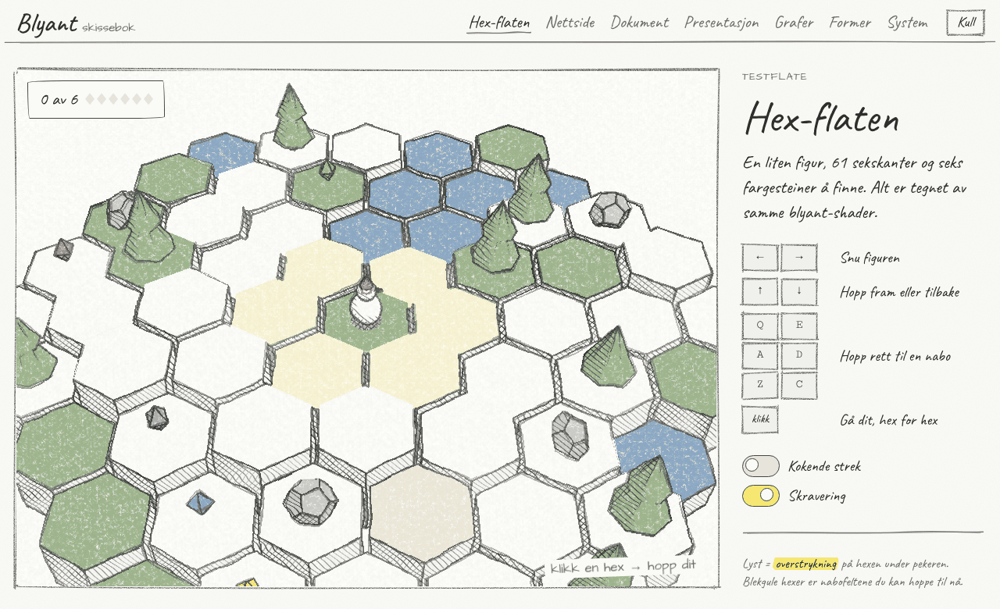

# Blyant

Blyant er et håndtegnet designsystem for spill, nettsider, dokumenter og presentasjoner. Det lar deg sette rammer, innhold og flyt med blyant før noen bestemmer seg for farger og merkevare. Alt er bygget slik at skisse-laget kan byttes ut med et ferdig design uten å røre strukturen.



## Kom i gang

Lenk inn stilarket og skriptet, og sett `b-page` på `body`:

```html
<link rel="stylesheet" href="dist/blyant.css">
<!-- bare hvis du skal bruke 3D (Sketch3D / HexBoard): -->
<script src="https://cdn.jsdelivr.net/npm/three@0.147.0/build/three.min.js"></script>
<script src="dist/blyant.js"></script>

<body class="b-page">
  <h1>Skisseboka</h1>
  <p>Sett rammene først. <mark>Pynten kommer etterpå.</mark></p>
  <button class="b-btn b-btn--primary">Lagre</button>
  <div id="graf"></div>
  <script>
    Blyant.ink(document);   // tegner blyantstreker rundt knapper, felt og bokser
    Blyant.chart.bar(document.getElementById("graf"), {
      title: "Hopp per runde",
      categories: ["R1", "R2", "R3"],
      series: [{ name: "Hopp", values: [14, 22, 19] }]
    });
  </script>
</body>
```

| Fil | Hva |
| --- | --- |
| `dist/blyant.css` | Fonter, tokens og alle komponenter i én fil |
| `dist/tokens.css` | Bare tokens som CSS-variabler (Papir og Kull) |
| `dist/blyant.js` | `Blyant`: streker, `ink`, `figure`, `Sketch3D`, `HexBoard`, `hexgrid` og `chart` |
| `tokens.json` | Kilden til alle tokens |
| `src/` | Kildekoden; `src/blyant.d.ts` beskriver API-et |
| `docs/komponenter/` | Retningslinjer per komponent |
| `examples/hex-skisse/` | Testflaten: hex-spill, nettside, dokument, presentasjon, grafer, former og system |

Endrer du `tokens.json` eller noe i `src/`, kjør `python3 build.py` for å bygge `dist/` og eksempelet på nytt.

Designsystemet finnes også som artefakt i Claude: <https://claude.ai/artifact/PHdDmrVn92a3Ly1Vx4398B>, og testflaten på <https://claude.ai/artifact/Eh4C4o74E2GKVp1y14DbMs>. Begge er private til du deler dem.

Se systemet i bruk på testflaten: [Hex-skisse](https://claude.ai/artifact/Eh4C4o74E2GKVp1y14DbMs). Der hopper en figur fra hex til hex, og skissene under spillet lenker videre til nettside, dokument, presentasjon, grafer, former og system.

## Prinsipper

- **Skisse først, stil etterpå.** Bruk Blyant til å bestemme *hva* som skal være på flaten og *hvordan* det henger sammen. Ikke bruk tid på pynt.
- **Grafitt bærer alt.** Svart, hvitt og gråtoner gjør nesten hele jobben. Farge er en effekt du legger på det ene leseren eller spilleren skal finne.
- **Én blyant overalt.** Den samme skjelvende streken brukes i HTML, i SVG og i 3D. Ingen flate får en annen hånd.
- **Gjentakbar uro.** Hver strek har et frø. Samme element tegnes likt hver gang, så skissen står stille mellom oppdateringer.

## Tre lag

| Lag | Hva | Hvor | Endres når designet kommer? |
| --- | --- | --- | --- |
| Struktur | `.b-*`-klasser, layout, tilstander, HTML | `src/blyant.css` del 2–6, markup | Nei |
| Skall | `--b-*`-variabler: font, strek, hjørner, skjelving, papirkorn | `src/blyant.css` del 1 | Ja, det er dette du bytter |
| Effekt | `dust-*`, `marker` | `tokens.json` | Sjelden |

Skisse-skallet er standard og står på egne ben. Når et ekte design skal på, skriver du ett nytt skall og setter `data-skin` på `<html>` (eller på en del av siden). `src/blyant.css` har et nøytralt `clean`-skall du kan kopiere fra:

```css
[data-skin="merkevare"] {
  --b-display: "Din Display", sans-serif;
  --b-body: "Din Tekst", sans-serif;
  --b-note: "Din Tekst", sans-serif;
  --b-radius: 6px;
  --b-radius-sm: 4px;
  --b-border: 1px;
  --b-inked-border: var(--line);   /* vanlig CSS-kant i stedet for blyantstrek */
  --b-ink-svg: none;               /* skjul blyantstrekene */
  --b-wobble: 0;                   /* 3D-shaderen tegner med linjal */
  --b-tilt: 0deg;
  --b-grain-img: none;
}
```

Bytt så fargetokenene hvis merkevaren trenger det. Klassene i markupen står urørt.

## Farger

- Sett sider og lerret på `paper`. Legg kort, notater og kodeblokker på `paper-2`. Bruk `paper-3` for valgt, trykket ned eller spor.
- Skriv tekst i `ink` (alias for `graphite-900`). Bruk `ink-soft` for metadata og hjelpetekst, men bare på `paper` og `paper-2`.
- Tegn kanter og figurer i `line` (`graphite-700`). Rutenett og hjelpelinjer er `line-faint`.
- De seks støvete fargene `dust-red`, `dust-orange`, `dust-yellow`, `dust-green`, `dust-blue` og `dust-purple` er fargeblyanter. Bruk dem til fyll, skravur, ikoner og steiner i spill. Aldri som brødtekst.
- Bruk `marker` som gul overstrykningstusj: bak et ord (`<mark>`), på valgt hex, på én knapp per visning. Tekst oppå tusjen er `on-marker`.
- Status bærer alltid et ord eller tegn i tillegg til fargen: «✗ Feil» i `dust-red`, «Klar» med prikk i `dust-green`.
- Maks to effektfarger synlige samtidig, pluss tusjen. Hvis alt er farget, er ingenting markert.

Temaene heter **Papir** (lyst) og **Kull** (mørkt). I Kull blir blyanten kritt: streker og tekst lyse på mørkt ark, og fargene løftes litt så de holder 3:1 mot `paper`.

## Typografi

- **Caveat** for overskrifter og tekst: rask, levende håndskrift. Lav x-høyde, så tekst settes større enn vanlig: brødtekst `t-body` er 20px.
- **Architects Daughter** for notater i margen (`t-note`, `.b-scribble`) og etiketter med store bokstaver (`t-label`, `.b-label`, tabellhoder, feltnavn). Den tynne, trykte streken gir arkitekt-følelse.
- **Cutive Mono** for kode, taster og tall i kolonner (`t-code`).
- Stilene: `t-display` (én per side), `t-h1`, `t-h2`, `t-h3`, `t-lead`, `t-body`, `t-small`, `t-label`, `t-note`, `t-code`.
- Overskrifter i Caveat 500. Ikke fet Architects Daughter: den har bare én vekt.
- Skriv kort og vanlig norsk. Sentence case i titler («Slik bygger du en hex-verden»), verb først på knapper («Meld meg på», «Legg ut steinene igjen»). Ingen emoji.

Fonten lastes fra Google Fonts:

```html
<link rel="stylesheet" href="https://fonts.googleapis.com/css2?family=Caveat:wght@400;500;600;700&family=Architects+Daughter&family=Cutive+Mono&display=swap">
```

## Strek og former

- Strektykkelser: `stroke-hair` for skravur og hjelpelinjer, `stroke-pencil` som standard, `stroke-bold` for valgt og fokus.
- Skjelving: `wobble-low` for små kontroller, `wobble-mid` som standard, `wobble-high` for løse kruseduller. Et skall med `--b-wobble: 0` tegner med linjal.
- Tegn i SVG med `Blyant.rough`: `line`, `rect`, `circle`, `ellipse`, `hex`, `poly`, `arrow`, `hatch` (skravur), `scribble`. Funksjonene gir tilbake en `d`-streng. `Blyant.figure(svg, [...])` tegner en hel figur med fargeblyant-fyll.
- Hver strek tegnes to ganger med litt ulik bue og overheng. Det er dette som gjør den håndtegnet. Ikke legg på `stroke-dasharray` for å få skisse-preg.
- Komponenter med kant (`.b-btn`, `.b-input`, `.b-box`, `.b-tag`, `.b-kbd`, `.b-ph`, `.b-slide`, valgt `.b-tab`) får ekte blyantstrek når du kaller `Blyant.ink(rot)`. Uten JavaScript faller de tilbake til CSS-kant med skjeve hjørner. Legg `data-ink="box|circle|underline|strike|hex|cross"` på et hvilket som helst element for å tegne rundt det.
- Notatlapper står litt skjevt (`--b-tilt`). Ingenting annet roteres.

## 3D

`Blyant.Sketch3D` er en three.js-renderer (r147, UMD) med et etterarbeid som tegner hele scenen med blyant:

1. Normaler og dybde blir kontur. Konturen tegnes to ganger med skjelving, som resten av systemet.
2. Lys blir skravur: én retning på halvskygge, kryss-skravur i skygge, tre retninger i mørkeste skygge.
3. Fargen på materialet blir fargeblyant med papirkorn. Hvite og grå materialer blir grafitt.
4. Papir og blyant hentes fra `--paper` og `--graphite-900`, så scenen følger Papir og Kull automatisk.

```js
const sketch = new Blyant.Sketch3D(el, { fov: 32 });
const box = new THREE.Mesh(new THREE.BoxGeometry(1, 1, 1), sketch.mat("--dust-blue"));
sketch.add(box);
sketch.start((dt) => { box.rotation.y += dt; });
```

- Bruk `sketch.mat(farge)` for alle meshes. Farge kan være et token (`"--dust-red"`), hex eller CSS-farge. `{ light: 0.1 }` gir fast mørk skravur, nyttig for skygger.
- Flate flater gir skarpe kanter. Kall `geometry.toNonIndexed(); geometry.computeVertexNormals()` på prismer og lav-poly figurer.
- La det være litt luft mellom like høye flater (for eksempel 93 % størrelse på hexer). Da finner shaderen kanten.
- `set({ lineWidth, hatchGap, hatch, boil })` justerer streken. `boil: true` lar streken «koke» seks ganger i sekundet. Slå det av ved `prefers-reduced-motion`.

**Fra Blender:** modeller med enkle, flate flater og navngi materialene etter tokens (`dust-red`, `marker`). Eksporter som glTF 2.0 (.glb) med normaler, last inn med `THREE.GLTFLoader` og bytt hvert materiale til `sketch.mat("--" + material.name)`. Grease Pencil og Line Art i Blender passer til stillbilder. For alt som skal kjøre i nettleseren bruker du shaderen.

`Blyant.HexBoard` er en ferdig hex-verden bygget på Sketch3D: terreng, trær, steiner, vann, seks fargesteiner og en figur som hopper. Piltaster snur og hopper, Q E A D Z C hopper direkte, klikk går dit hex for hex. `Blyant.hexgrid` har den aksiale matematikken (`toXZ`, `dist`, `ring`, `path`).

## Grafer

`Blyant.chart` tegner grafer med samme blyant: `line`, `bar` (loddrett, vannrett, stablet), `scatter`, `segments` (del av helhet), `stat` (nøkkeltall) og `spark` (trendlinje). Gi grafen en tom boks og dataene; den fyller bredden og tegner seg på nytt ved ny størrelse.

```js
Blyant.chart.line(el, {
  title: "Spillere per dag",
  x: ["3.11", "4.11", "5.11"],
  series: [{ name: "Hex-flaten", values: [140, 162, 171] }, { name: "Myra", values: [90, 88, 97] }]
});
```

- Seriene får `chart-1` til `chart-6` i fast rekkefølge: blå, oransje, lilla, grønn, gul, rød. Rekkefølgen er testet for fargesvakhet og normalt syn i både Papir og Kull. Gi en serie `color: "--chart-3"` for å holde fargen når et filter fjerner andre serier.
- `chart-*` er fargeblyant trykket hardt, med mer farge enn `dust-*`. Bruk `dust-*` til illustrasjon og spill, `chart-*` til data.
- Flere enn seks serier blir «Andre» eller flere små grafer, aldri en sjuende farge. Punktdiagram tar høyst tre serier.
- Én akse per graf. To mål med ulik skala blir to grafer.
- Rutenett er hårfine `line-faint`-streker; grunnlinjen er `line`. Tekst og tall står i `ink` og `ink-soft`, aldri i seriefargen.
- Legende for to eller flere serier, direkte etiketter bare der historien er: linjeenden, toppen, den uthevede stolpen.
- `highlight` legger tusj bak én kategori og graner ut resten. Bruk det når grafen har ett poeng.
- Hver graf har verktøytips på hover og tastatur (piltaster når grafen har fokus) og en tabell: `chart.table(true)`. Verktøytipset er aldri eneste vei til et tall.
- Eksempeldata merkes som eksempeldata i undertittel eller etikett.

## Flater

- **Nettside:** `.b-page` på `body` gir papir, korn og prosa-stiler for vanlige HTML-elementer. Bruk `.b-nav`, `.b-btn`, `.b-field`, `.b-box`, `.b-table`, `.b-ph` for bilder som ikke finnes ennå.
- **Dokument:** vanlig HTML inne i `.b-prose`. `<mark>` er tusj, `.b-scribble` er margnotat, `.b-callout` er en tegnet ramme rundt et poeng.
- **Presentasjon:** `.b-slide` er en 16:9-ramme som skalerer alt etter bredden (container-enheter). Bruk `.b-slide__kicker`, `.b-slide__title`, `.b-slide__body`, `.b-slide__foot`.
- **Spill:** `Blyant.Sketch3D` eller `Blyant.HexBoard` i et `.b-canvas`, HUD i vanlige komponenter oppå.
- **Dashbord og rapport:** en rad `Blyant.chart.stat` øverst, ett filter-rad over grafene, og grafer i `.b-box`-kort med en «Vis tabell»-knapp.

## Ikoner

Blyant har ingen ikonfont. Tegn små ikoner med `Blyant.figure` i en 64×64 `viewBox` med `stroke-pencil`, eller bruk Unicode-piler (← → ↑ ↓ ↳) i teksten. Hold ikoner i `ink`, med høyst én effektfarge som fyll.

## Tilgjengelighet

- Fokus er en solid ring i `focus`, 2,5px, 3px utenfor kanten. Minst 3:1 på alle papirflater i begge temaer.
- `ink` holder 11:1 eller bedre mot alle papir-tokens. `ink-soft` holder 4,5:1 mot `paper` og `paper-2`, men ikke mot `paper-3` i Papir.
- Effektfargene er for fyll og streker. `dust-blue` er under 3:1 på `paper-2` i Papir og må aldri bære mening alene der.
- Animasjon (hopp, kokende strek, hover) respekterer `prefers-reduced-motion`.
