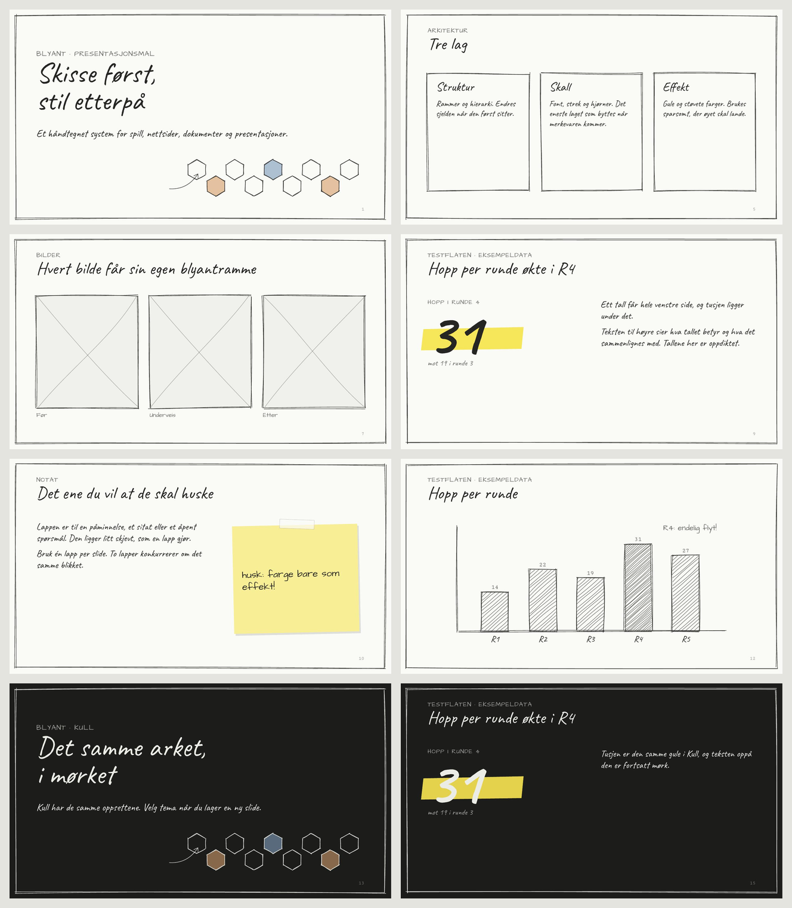

# Presentasjonsmal for PowerPoint

Blyant som PowerPoint-mal: temaene Papir og Kull, seksten oppsett i hvert, skriftene, graf-fargene, en tabellstil og blyantstreker som er tegnet av `Blyant.rough`. Malen bygges fra `tokens.json` og `src/blyant.js`, så den følger designsystemet og har samme versjon som pakken.



| Fil | Hva |
| --- | --- |
| `dist/blyant.potx` | Malen. Dobbeltklikk, så åpner PowerPoint en ny presentasjon bygget på den. |
| `dist/blyant-eksempel.pptx` | De samme oppsettene fylt ut. Til Google Slides, Keynote og LibreOffice, som ikke åpner `.potx` like godt, og til kode som fyller ut malen. |

Hent en fast versjon fra jsDelivr: `https://cdn.jsdelivr.net/npm/blyant@X.Y.Z/dist/blyant.potx`. README-en har lenken til den nyeste. `npm install blyant` gir de samme filene i `node_modules/blyant/dist/`.

## Før du begynner: skriftene

Malen bruker Caveat, Architects Daughter og Cutive Mono. De er gratis og må være installert på maskinen du lager presentasjonen på:

- [Caveat](https://fonts.google.com/specimen/Caveat): titler og brødtekst
- [Architects Daughter](https://fonts.google.com/specimen/Architects+Daughter): stikkord, notater, bildetekster
- [Cutive Mono](https://fonts.google.com/specimen/Cutive+Mono): bunntekst og tall i kolonne

Uten dem bytter PowerPoint til en annen skrift, og da er det ikke Blyant lenger. Malen ber PowerPoint bygge skriftene inn i filen når du lagrer (Fil → Alternativer → Lagre → «Bygg inn skrifter i filen»), så den du sender presentasjonen til, trenger dem ikke. Sjekk at valget står på før du sender noe fra deg.

## Temaer

Papir og Kull ligger som to lysbildemaler i samme fil. Du velger tema per slide under Oppsett, og kan blande dem: Kull på tittel og seksjon, Papir på innholdet. Fargene ligger slik i temaet:

| I PowerPoint | Token | Bruk |
| --- | --- | --- |
| Tekst 1 | `ink` | Tekst, og blyantstrek med lavere dekkevne |
| Tekst 2 | `ink-soft` | Stikkord, bunntekst, bildetekst |
| Bakgrunn 1 | `paper` | Arket |
| Bakgrunn 2 | `paper-2` | Et ark som ligger oppå |
| Uthevingsfarge 1–6 | `chart-1` til `chart-6` | Graf-serier, i fast rekkefølge |
| Egendefinerte farger | `marker`, `dust-*`, `paper-3`, `graphite-*` | Effektfarger og hjelpelinjer |

En graf du setter inn i PowerPoint, får graf-fargene av seg selv. En ny form er et ark i `paper-2` med blyantkant, ikke en blå boks. Tabeller får stilen «Blyant»: stikkord i hodet og stiplede linjer mellom radene.

## Oppsett

| Oppsett | Til |
| --- | --- |
| Tittel | Forsiden. Stikkord, stor tittel, undertittel og raden med hexer. |
| Seksjon | Starten på en ny del. Arket er `paper-2`, med en skravert hex. |
| Tittel og innhold | Det vanlige: tekst, tabell, graf eller bilde under tittelen. |
| To kolonner | To ting ved siden av hverandre, med en lett blyantstrek mellom. |
| Tre bokser | Tre likestilte poeng, hvert i sin `Box` med overskrift og tekst. |
| Bilde og tekst | Tekst til venstre, bilde til høyre i blyantramme. |
| Bilde | Ett stort bilde i blyantramme under tittelen, med bildetekst. |
| To bilder | To bilder side om side, hvert i sin ramme med bildetekst. |
| Tre bilder | Tre bilder på rad: før, underveis, etter. |
| Fullskjerm bilde | Bildet er hele lysbildet, fra kant til kant. Ingen tittel og ingen bunntekst. |
| Fullskjerm video | Det samme for en video. |
| Stort tall | Ett tall (`Stat`) med tusj under, og teksten som sier hva det betyr. |
| Notatlapp | En `Note` med teip, litt skjev. Til det ene de skal huske. |
| Innhold og margnotat | Innhold med en kommentar i margen og en pil som peker. |
| Bare tittel | Til en figur du tegner selv. |
| Tomt | Bare ramma. |

**Bilder.** Der et bilde skal inn, står ruta med kryss (`Placeholder`) til bildet kommer. Klikk på ikonet i ruta eller slipp et bilde på den. Bildet beskjæres så det fyller ruta, og blyantramma ligger rundt det. Ramma hører til oppsettet og ikke til bildet: flytter du bildet, blir ramma stående. I fullskjerm dekker bildet hele lysbildet, også ramma rundt arket.

Alle oppsett utenom fullskjerm har stikkordet over tittelen og en bunntekst i mono: tekst til venstre, dato og nummer til høyre. Bunnteksten slår du på under Sett inn → Topptekst og bunntekst. Første nivå i en tekstboks er et avsnitt uten punkt. Trykk Tab for en liste med den lille ringen fra prosa-listene.

**Navn.** Plassholderne har faste navn (Stikkord, Tittel, Innhold, Bilde 1, Bildetekst 1 og så videre), og blyantstrekene heter Ramme, Boks, Pil, Skille og Blyantstrek. Du ser dem i valgruten (Hjem → Ordne → Valgrute). Navnene er de samme som feltene i en definisjon, se under.

**Notater.** Notatsiden har lysbildet øverst og manuset under, på papir i begge temaer.

## Retningslinjer

De samme som for [Slide](komponenter/Slide.md):

- Én tanke per slide. Tittelen er påstanden, ikke temaet: «Hopp per runde økte i R4», ikke «Resultater».
- Farge er effekt. Tusjen brukes på det ene øyet skal finne, og bare én gang per slide.
- Eksempeldata merkes som eksempeldata i stikkordet eller bunnteksten.
- Trenger du en strek, en ramme eller en skravur som malen ikke har, tegn den med `Blyant.rough` og lim den inn som SVG, i stedet for å tegne en rett strek i PowerPoint.

## Fra en samtale med Claude

Skillen `skills/blyant-presentasjon/` lar deg snakke deg gjennom en presentasjon med Claude, eksportere den til PowerPoint og jobbe videre der. Den har tre deler:

- **Definisjonen.** Mens dere snakker, holder Claude presentasjonen som en liten JSON-fil: hvilke slides, hvilket oppsett hver har, og hva som står i feltene. Feltene heter det samme som plassholderne i malen.
- **Eksporten.** `lag_presentasjon.py` fyller ut malen fra definisjonen og skriver en vanlig `.pptx`. Skriptet trenger bare Python, og leser oppsettene ut av malen, så det følger den versjonen det får.
- **Reglene.** Skillen beskriver hvordan en Blyant-slide skal se ut og hvordan man jobber i en Blyant-presentasjon i PowerPoint, så Claude i PowerPoint bruker oppsettene, temafargene og blyantstrekene i stedet for å finne på sine egne.

```json
{
  "tittel": "Hex-skisse etter fem runder",
  "tema": "papir",
  "bunntekst": "Hex-skisse · eksempeldata",
  "slides": [
    {"oppsett": "Tittel", "tema": "kull", "stikkord": "Testflaten", "tittel": "Hex-skisse etter\nfem runder"},
    {"oppsett": "Tittel og innhold", "tittel": "Tre grep ga flyten",
     "innhold": ["De virket ==sammen==.", ["En tydelig start-hex.", "Færre farger."]],
     "notater": "Det du sier til denne sliden."},
    {"oppsett": "Bilde", "tittel": "Start-hexen er lettere å finne nå", "bilde": "brett.png", "bildetekst": "Etter runde 4"},
    {"oppsett": "Tittel og innhold", "tittel": "Bom per runde gikk ned",
     "innhold": {"tabell": [["Runde", "Bom"], ["R1", 9], ["R2", 8]]}}
  ]
}
```

```bash
python3 skills/blyant-presentasjon/lag_presentasjon.py presentasjon.json
```

```bash
python3 skills/blyant-presentasjon/lag_presentasjon.py --oppsett
```

Den første skriver `presentasjon.pptx`. Den andre viser oppsettene og feltene i malen. Hele formatet står i `skills/blyant-presentasjon/SKILL.md`, og `eksempel.json` i samme mappe er en hel definisjon. Kort fortalt:

- En streng er ett avsnitt, en liste er flere, og en liste inni en liste er punkter. `==ord==` får gul tusj, `**ord**` blir fet.
- Et bilde er en filsti (PNG, JPEG eller GIF). Et bildefelt uten bilde viser ruta med kryss, klar til at du slipper et bilde på den i PowerPoint.
- `notater` blir manuset i notatfeltet. `tema` kan settes for hele presentasjonen og for én slide.
- Video, SVG, grafer og egne tegninger kan ikke eksporteres. De setter du inn i PowerPoint etterpå.

Etter eksporten er det `.pptx`-fila som gjelder. Skriptet skriver ikke over en fil som er lagret fra PowerPoint, med mindre du ber om det med `--overskriv`.

### Få skillen inn i Claude

- **Claude Code og Cowork på egen maskin:** lenk mappa inn ved siden av `blyant`-skillen.

  ```bash
  ln -s ~/github/blyant/skills/blyant-presentasjon ~/.claude/skills/blyant-presentasjon
  ```

- **Claude på nett, i appen og i PowerPoint:** last ned <https://phareim.github.io/blyant/blyant-presentasjon.zip> (eller bygg den med `python3 build.py --skill`) og last den opp under Customize → Skills. Zip-fila har malen med seg, så eksporten virker uten nett. Skills du har slått på der, følger med inn i Claude for PowerPoint, og kan kalles med `/` i sidepanelet. Last opp på nytt når malen får en ny versjon.

Claude i PowerPoint har også et felt for faste instrukser (Innstillinger → Instructions). Denne teksten passer der, og virker også uten skillen:

> Denne presentasjonen bruker Blyant-malen. Lag nye slides fra oppsettene i malen og fyll ut plassholderne, i stedet for å legge til frie tekstbokser. Bruk bare temafargene og skriftene Caveat, Architects Daughter og Cutive Mono. Én tanke per slide, og tittelen er påstanden. Gul tusj (fargen «marker») brukes høyst én gang per slide. Ikke tegn rette linjer eller standardformer: kopier blyantstrekene som finnes. Ikke endre lysbildemalen.

## Versjon

Malen har samme versjon som pakken. `blyant@0.12.0` inneholder malen for 0.12.0, og hver endring i tokens, streker eller oppsett gir en ny versjon på npm. Versjonen står tre steder i filen, så du kan se hva en gammel presentasjon er laget med:

- i temanavnet: «Blyant 0.12.0 Papir» (hold pekeren over temaet under Utforming)
- under lysbildet i malvisningen (Visning → Lysbildemal)
- i filegenskapene: nøkkelord, beskrivelse og den egendefinerte egenskapen `BlyantVersjon`

En presentasjon endrer seg ikke når en ny versjon kommer. Vil du ha den over på en nyere mal: Utforming → Temaer → Bla gjennom etter temaer, og velg den nye `blyant.potx`.

- `patch`: justeringer i et oppsett, en farge eller en strek.
- `minor`: et nytt oppsett, eller et oppsett som bytter navn eller plassholdere. Før 1.0 er brudd også `minor`.

## Fra kode

`python-pptx` åpner ikke `.potx`. Bruk `blyant-eksempel.pptx`, fjern eksempel-slidene og legg til nye fra oppsettene:

```python
from pptx import Presentation

p = Presentation("blyant-eksempel.pptx")
for s in list(p.slides._sldIdLst):          # fjern eksempel-slidene
    p.part.drop_rel(s.rId)
    p.slides._sldIdLst.remove(s)

papir, kull = p.slide_masters
s = p.slides.add_slide(papir.slide_layouts.get_by_name("Stort tall"))
felt = {f.placeholder_format.idx: f for f in s.placeholders}
s.shapes.title.text = "Hopp per runde økte i R4"
felt[13].text = "Testflaten · eksempeldata"   # stikkordet har idx 13 i alle oppsett
felt[15].text = "31"
p.save("presentasjon.pptx")
```

Til en vanlig presentasjon er `lag_presentasjon.py` over enklere. Plassholderne har faste `idx`: tittel 0, hovedinnhold 1, stikkord 13. Bilder har 2, 4 og 6 fra venstre, og bildeteksten under har tallet etter (3, 5 og 7). Et bilde settes inn med `felt[2].insert_picture("bilde.png")`. Resten står i `oppsett()` i `mal/potx.py`.

## Bygging

`python3 build.py` bygger malen sammen med resten av `dist/`. Koden ligger i `mal/`:

- `mal/potx.py` setter sammen temaene, oppsettene og eksempelet, og skriver PowerPoint-pakken direkte. Fargene, skriftene og strektykkelsene leses fra `tokens.json`.
- `mal/streker.js` kjører `Blyant.rough` fra `src/blyant.js` i Node og gir tilbake strekene. Byggingen trenger derfor Node.

Samme kilde gir samme fil, byte for byte, så `dist/blyant.potx` committes sammen med resten av `dist/`.

## Det malen ikke har

- Papirkorn og grafittkorn. Strekene er vektorformer, ikke piksler, og arket er en ren farge.
- Håndtegnede grafer. En graf fra PowerPoint får fargene, men rette streker. Skal grafen være tegnet, lag den med `Blyant.chart` og sett den inn som bilde, eller tegn den med `Blyant.rough` slik eksempelet gjør.
- Animasjoner og overganger.
- LibreOffice Impress viser bunnteksten midtstilt i sin egen skrift. Resten av malen ser lik ut der.
